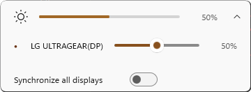
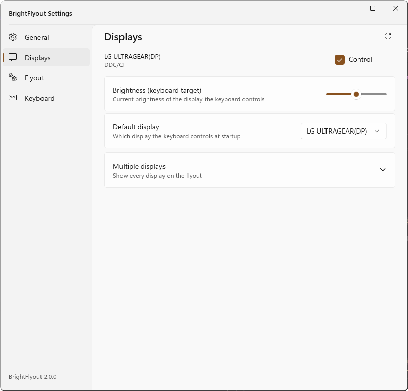
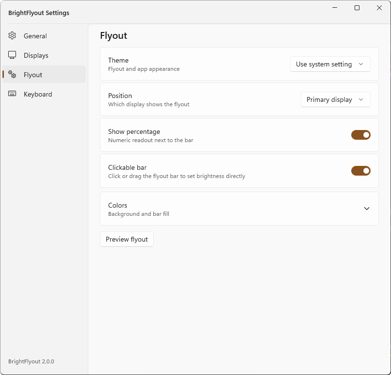

# BrightFlyout

Control your monitor brightness with the keyboard, with a proper flyout —
including external monitors that Windows itself can't adjust.

BrightFlyout is a small Windows tray app (WinUI 3) that turns your keyboard's
brightness keys into a universal brightness control: it drives external monitors
over **DDC/CI** and laptop panels through the built-in Windows interface, and
replaces the plain built-in popup with its own Windows-11-style flyout.


## What it does

- **External monitor brightness from the keyboard.** Sends DDC/CI commands
  (VCP `0x10`) to any monitor that supports them — most do. Rapid key presses
  are coalesced so your monitor never chokes on slow I2C transactions.
- **Laptop panels too.** Internal displays are driven through Windows' own WMI
  brightness interface, so one app covers your whole setup. On laptops, where
  Windows insists on handling the keys itself, BrightFlyout mirrors the change
  into its flyout — and if the panel isn't your keyboard target, it instantly
  reverts Windows' change and drives your chosen display instead.
- **Works with real brightness keys.** Standard keyboards report brightness as
  HID consumer-control usages (`0x006F`/`0x0070`), which normal hotkey APIs
  can't see. BrightFlyout listens via Raw Input, so those keys just work —
  including hold-to-repeat. A low-level keyboard hook with configurable
  virtual-key codes covers exotic keyboards.
- **A flyout that looks like it belongs.** A faithful Windows 11 OSD replica:
  acrylic, rounded, above the taskbar, with a percentage readout. The built-in
  Windows OSD is suppressed only while ours is visible and always restored
  afterwards — volume and other system flyouts are unaffected.
- **Multi-display aware.** Expand the flyout for one slider per display, sync
  all displays together, pick which display the keys control, and exclude
  displays you don't want touched. Monitors are hot-plug and input-switch
  tolerant — changes are picked up automatically.



- **Styleable.** System theme by default (light/dark follows Windows), with
  optional custom background and bar colors, adjustable brightness step and
  flyout duration, and the choice of showing the flyout on your primary
  display or all of them.
- **Quiet and unobtrusive.** Lives in the system tray (right-click for
  Settings, Refresh displays, Exit; double-click opens Settings). Optionally
  starts with Windows. Notifies you once when a new release is out.
- **Windows 10 and 11**, x64.

## Install

1. Download `BrightFlyout_AOT_x64.msix`, `BrightFlyout.cer` and
   `Install-BrightFlyout.ps1` from the latest
   [release](https://github.com/pawdy3/brightness-flyout/releases) into one
   folder.
2. Run the script:

   ```powershell
   .\Install-BrightFlyout.ps1
   ```

   It trusts the self-signed certificate once per machine (the only step that
   asks for admin), closes a running instance, and handles upgrades,
   downgrades and same-version rebuilds. If the app was running, it is
   started again afterwards.

Upgrades are in-place and keep your settings
(`%LOCALAPPDATA%\BrightFlyout\settings.json`). Uninstall via
*Settings → Apps* like any other app.

> First install pulls the Windows App SDK runtime from the Microsoft Store
> automatically (one-time, needs network + Store access).

## Settings

Right-click the tray icon → **Settings**. Four pages: **Displays** (inclusion,
keyboard target, default display), **Flyout** (theme, position, colors,
percentage readout, clickable bar — you can click or drag the bar itself),
**Keyboard** (Raw Input toggle, advanced VK codes), **General** (brightness
step, flyout duration, run at startup).





## For developers

### Prerequisites

- .NET 10 SDK
- Windows App SDK 2.6 runtime (unpackaged dev builds bootstrap against it;
  if the app fails to start with a missing-runtime error, install any released
  MSIX once or run `windowsappruntimeinstall-x64.exe` from the
  [Windows App SDK downloads](https://learn.microsoft.com/windows/apps/windows-app-sdk/downloads))
- MSVC C++ build tools (only for NativeAOT release builds)

### Development inner loop

Day-to-day development does **not** need the MSIX machinery (packaging,
signing, AOT) — that is for releases only:

```powershell
.\tools\dev-run.ps1                    # kill running instance, Debug build, launch
.\tools\dev-run.ps1 -Release           # optimized JIT build instead (still seconds)
.\tools\dev-run.ps1 -OpenSettings      # launch straight into the settings window
.\tools\dev-run.ps1 -NoLaunch          # just build
```

Plain `dotnet` equivalent: `dotnet build -c Debug -p:Platform=x64 -r win-x64`,
exe lands in `bin\x64\Debug\net10.0-windows10.0.19041.0\win-x64\`.

Other dev affordances:

- Diagnostics go to `%LOCALAPPDATA%\BrightFlyout\debug.log` (bounded, 256 KB;
  the file stays movable/copyable while the app runs).
- `BrightFlyout.exe --open-settings` opens the settings window at startup.

### Integration tests

```powershell
.\tools\test-integration.ps1               # build Debug, run the suite
.\tools\test-integration.ps1 -SkipBuild    # reuse the existing Debug build
```

The suite runs the real app against **simulated in-memory displays**, so no
DDC/CI hardware is needed. Covered: cold start (hook, display detection),
single-instance behavior, keyboard injection → brightness step → OSD (verified
by screenshot diff), OSD auto-hide, tray icon registration, settings window.
Any already-running BrightFlyout instance is killed first.

Test hooks (environment variables, honored at startup):

| Variable | Effect |
|---|---|
| `BRIGHTFLYOUT_SIMULATE_DISPLAYS` | two in-memory displays replace hardware enumeration; no DDC/CI or WMI calls |
| `BRIGHTFLYOUT_APPDATA` | redirects settings.json/debug.log to the given directory |
| `BRIGHTFLYOUT_WMI_SELFTEST` | runs a WMI connectivity self-test at startup (works on machines without an internal panel) |

Exit code is non-zero if any test fails; on failure the isolated app-data
directory is kept at `%TEMP%\BrightFlyoutIntegrationTests` for inspection.

### Release builds

CI (`.github/workflows/build.yml`) produces two MSIX packages on every push,
and attaches them to a GitHub Release when a `v*` tag is pushed:

| Artifact | Size | Contains |
|---|---|---|
| `BrightFlyout_AOT_x64.msix` | ~5 MB | NativeAOT exe, nothing required — full feature set, including internal laptop panels (WMI via WmiLight, which is AOT-compatible) |
| `BrightFlyout_Hybrid_x64.msix` | ~11 MB | regular build + trimmed .NET 10 runtime (fallback variant) |

(A framework-dependent variant was evaluated and dropped: it still needs ~9 MB
of WASDK managed projections in the package — MSIX framework packages share
native code only — and trimming requires self-contained, so it would barely
beat the hybrid while adding a .NET runtime requirement.)

Both pull the Windows App SDK 2.6 automatically as a framework package from
the Microsoft Store at install. Pick AOT; the hybrid variant exists as a
fallback.

Local equivalents (MSIX variants sign with `certs\BrightFlyout.pfx`
automatically if present; when publishing both, wipe `bin`/`obj` between them —
switching `PublishAot` on shared intermediates has produced corrupted
packages):

```powershell
# portable NativeAOT single exe, no installer, zero prerequisites
# (self-contained Windows App SDK - unpackaged apps can't pull it from the Store)
dotnet publish -c Release -p:Platform=x64 -r win-x64 -p:PublishAot=true `
  -p:WindowsAppSDKSelfContained=true

# AOT MSIX -> AppPackages\..._x64_Test\
dotnet publish -c Release -p:Platform=x64 -r win-x64 -p:BuildMSIX=true -p:PublishAot=true

# hybrid MSIX -> AppPackages\..._x64_Test\
dotnet publish -c Release -p:Platform=x64 -r win-x64 -p:BuildMSIX=true -p:PublishAot=false `
  -p:SelfContained=true -p:PublishTrimmed=true
```

### Releasing

```powershell
git tag v2.0.1
git push origin v2.0.1
```

CI signs the MSIX with the stable cert from the **`MSIX_CERT_PFX_BASE64`**
repository secret (base64 of `certs\BrightFlyout.pfx`):

```powershell
[Convert]::ToBase64String([IO.File]::ReadAllBytes("certs\BrightFlyout.pfx"))
# -> GitHub repo -> Settings -> Secrets and variables -> Actions -> New repository secret
```

Keep `certs\` private (gitignored) and back it up — a new cert means every
machine has to trust it again before upgrading. The cert is valid until 2051.

## Notes

- If your keyboard emits actual virtual-key codes for brightness instead of
  HID consumer usages, set them (hex) under *Settings → Keyboard*.
